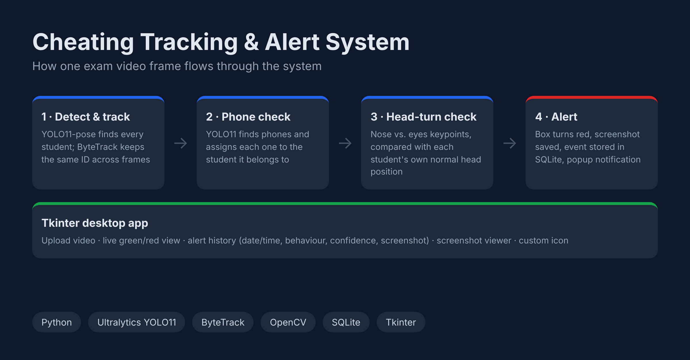

# 🎓 Cheating Tracking & Alert System

A desktop app that watches an exam video, tracks every student, and flags suspicious behaviour. When a student uses a phone or turns their head toward a neighbour's paper, their box turns red, a screenshot is saved, the event is logged in a SQLite database and a notification pops up.



Built as part of the Instant Software Solutions AI & Data Analysis training.

---

## ✨ Features
- **Upload a video** from the app and watch it being processed live
- **Student tracking** with YOLO11-pose + ByteTrack, so each student keeps the same ID across frames
- **Green box** for normal students, **red box** while a student is flagged
- **Phone detection**: YOLO11 finds phones and each phone is assigned to the one student holding it
- **Head-turn detection** based on face keypoints (nose vs. eyes)
- **Automatic screenshots** in `alerts/screenshots/`
- **SQLite log** of every alert: date/time, behaviour, confidence, student ID, video time and screenshot path
- **Popup notification** for every alert
- **Alert history** table, **screenshot viewer** and a custom app icon

## ⚙️ How detection works
| Step | What happens |
|---|---|
| Track | `yolo11n-pose` detects people and 17 keypoints; ByteTrack gives each person a stable ID |
| Phone | `yolo11n` looks for COCO class 67 (cell phone). Boxes wider than 3:1 are dropped, since a notebook was being picked up as a phone. Each phone goes to the student whose box contains it; if boxes overlap, the largest (closest) one wins |
| Head turn | Yaw = how far the nose sits from the midpoint of the eyes, divided by eye distance. Each student is compared with their **own** rolling median over the last 5 s, so someone sitting at an angle to the camera is not flagged all the time |
| Debounce | A behaviour has to last 0.5 s (phone) or 0.75 s (head turn) before it counts, and each student/behaviour pair has a 10 s alert cooldown |

All thresholds are in the settings block at the top of [`detector.py`](detector.py).

## 🚀 Quick start
```bash
git clone https://github.com/7zumax/cheating-tracking-system.git
cd cheating-tracking-system
pip install -r requirements.txt
python app.py
```
Click **Upload Video** and choose an exam video. The YOLO weights download automatically on the first run.

To run the detector without the app:
```bash
python test_detector.py "path/to/videos"
```

## 📁 Project structure
```
├── app.py             # Tkinter app (entry point)
├── detector.py        # tracking, phone and head-turn rules, drawing
├── database.py        # SQLite storage (alerts.db)
├── test_detector.py   # command-line test over a folder of videos
├── assets/            # app icon
└── docs/              # images for this README
```

## ⚠️ Limitations
- Head-turn detection needs a visible face. Blurry or side-on faces give no keypoints, so those students can't be checked for head turns.
- Phone detection uses a general COCO model and misses phones that are mostly hidden by a hand.
- The system flags moments for a person to review; it does not decide who cheated.

## 🔜 Next steps
- Move alert storage to Firebase so alerts can be reviewed from anywhere
- Train a custom model on exam footage for phones and cheat sheets

## 🛠️ Tech stack
Python · Ultralytics YOLO11 · ByteTrack · OpenCV · SQLite · Tkinter · Pillow
